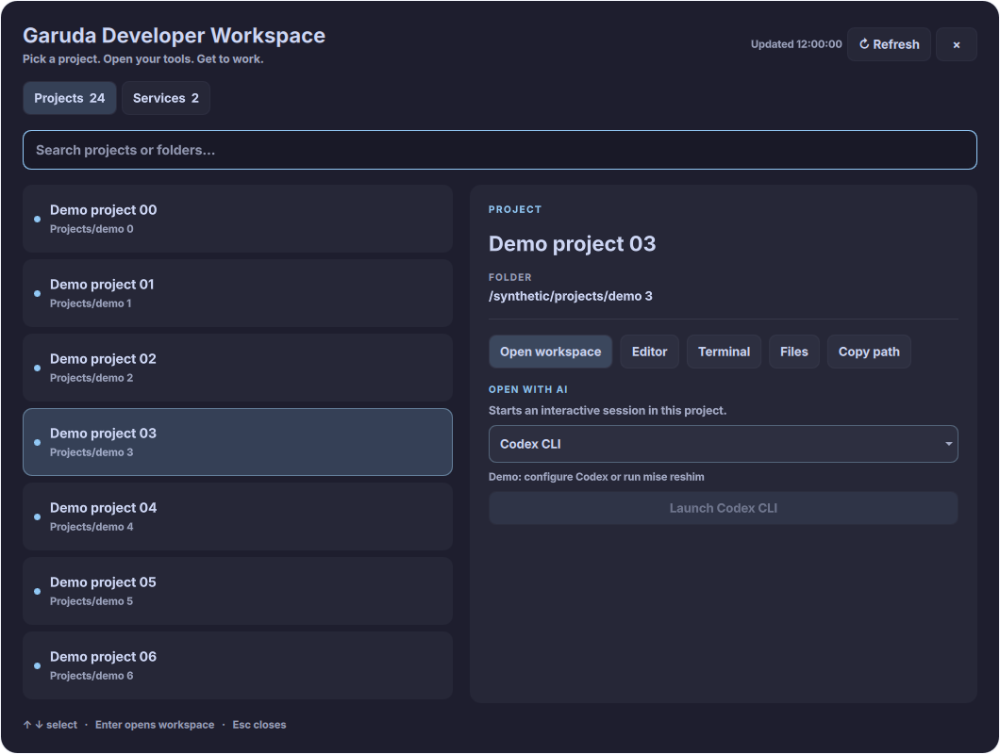
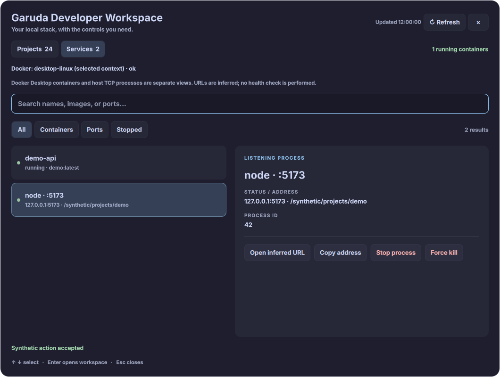

# Garuda Developer Workspace

A standalone Quickshell desktop application for **Garuda Linux, KDE Plasma and
Wayland**. It reuses the MIT-licensed Omarchy Developer Workspace's Python backend
and QML interface without requiring Omarchy, Hyprland, a shell plugin host, or
`uwsm-app`. There is no web server, Electron, database, or Python package dependency.

- **Projects:** search Git and common language projects; open VS Code, Konsole,
  both together, a file manager, or an interactive Codex, Claude or Antigravity CLI;
  copy project paths.
- **Services:** list Docker containers and host TCP listeners; inspect containers,
  follow logs, start/stop/restart, remove stopped containers while retaining volumes,
  and signal eligible project processes after explicit confirmation.
- A resizable desktop window, system light/dark palette, keyboard selection,
  details and action feedback. Five-second service polling retains selection and
  scroll and pauses while hidden, minimized, confirming, scanning or acting.

The app never runs repository scripts automatically. This compatibility port does
not include Compose orchestration, resource monitoring or window arrangement.

## Dependencies

Required: Quickshell **0.3.x**, Qt 6 Quick Controls (provided by `qt6-declarative`),
Python **3.12+** (locally checked with 3.14.7), Bash, `flock` (util-linux), `ss`
(iproute2), `xdg-open`, Konsole and your editor. The defaults use `code` and
`konsole` on PATH. Terminal overrides must accept Konsole's `--workdir`, `--hold`
and `-e` arguments. No terminal command templates or shell command strings are used.

Optional: Docker CLI and an accessible engine/Docker Desktop; `less` for inspect
paging; the AI CLIs. Backend-only clipboard commands can use `wl-copy`
(wl-clipboard) on Wayland or `xclip` on X11; the desktop UI uses Qt directly.
Missing optional capabilities are reported in the interface. Process controls
require Linux pidfds and Python's `os.pidfd_open` / `signal.pidfd_send_signal`.

On **2026-10-14**, Arch Extra and this Garuda environment's package metadata list
[quickshell 0.3.2](https://archlinux.org/packages/extra/x86_64/quickshell/), with
`qt6-declarative` and `qt6-wayland` dependencies. Package availability for
`python`, `konsole`, `xdg-utils`, `iproute2`, `wl-clipboard` and `util-linux` was
also checked with `pacman -Si`. Install missing dependencies yourself:

```fish
sudo pacman -Syu --needed quickshell python konsole xdg-utils iproute2 wl-clipboard util-linux
quickshell --version
```

Your existing `/usr/bin/code`, fish, Docker Desktop and AI tools can be kept. The
installer does not install packages, change KDE settings, enable autostart, modify
the shell/session/GPU, or request sudo.

## Install and launch

From this repository:

```fish
./install.sh
fish_add_path "$HOME/.local/bin"
garuda-developer-workspace
garuda-developer-workspace services
```

Alternatively launch `~/.local/bin/garuda-developer-workspace` directly or use
**Garuda Developer Workspace** in KDE's application menu. Its menu action opens
Services. For development, use `./bin/garuda-developer-workspace` from the checkout.
Use the launcher consistently: it serializes startup using `flock`, checks
Quickshell's `--no-duplicate` flag, then calls a typed IPC handler and waits for an
explicit acknowledgment. Repeated launches reopen the existing window.

Code goes into `$XDG_DATA_HOME/garuda-developer-workspace` (default
`~/.local/share/garuda-developer-workspace`); the launcher into `$XDG_BIN_HOME`
(default `~/.local/bin`); the menu entry and SVG icon into the usual user data
folders. Settings live separately in `$XDG_CONFIG_HOME/garuda-developer-workspace`
(default `~/.config/garuda-developer-workspace`). XDG paths must be absolute.

Closing the title bar, the close button or Escape hides the window and stops
polling. A lightweight Quickshell instance stays available for reopening; it is
not an autostart service. To exit it completely:

```fish
quickshell ipc --path "$HOME/.local/share/garuda-developer-workspace/plugin/shell.qml" call workspace quit
```

Use your actual `$XDG_DATA_HOME` instead if customized. To diagnose startup errors:

```fish
quickshell --path "$HOME/.local/share/garuda-developer-workspace/plugin/shell.qml"
quickshell log --path "$HOME/.local/share/garuda-developer-workspace/plugin/shell.qml" --tail 100
```

The implementation uses the official [FloatingWindow lifecycle](https://quickshell.org/docs/v0.3.0/types/Quickshell/QsWindow/),
[typed IPC](https://quickshell.org/docs/v0.3.0/types/Quickshell.Io/IpcHandler/) and
[launch path selection](https://quickshell.org/docs/v0.3.0/guide/introduction/), and
its flags/AppId pragma were checked against the 0.3.2 source and binary. Future
Quickshell major/minor releases need revalidation.

## Configuration

Edit `~/.config/garuda-developer-workspace/config.json`, then Refresh:

```json
{
  "projectRoots": ["~/Projects", "~/work space"],
  "maxDepth": 4,
  "editor": {"executable": "/usr/bin/code", "arguments": ["--new-window"]},
  "terminal": {"executable": "/usr/bin/konsole", "arguments": ["--separate"]},
  "shell": "/usr/bin/fish",
  "aiExecutables": {
    "codex": "~/.local/share/mise/shims/codex",
    "claude": "~/.local/bin/claude",
    "agy": null
  },
  "dockerContext": null
}
```

`null` AI overrides resolve tool names (`codex`, `claude`, `agy`) through PATH.
`null` shell uses `SHELL`, then fish. Executables accept PATH names or absolute/`~/`
paths. Arguments are JSON arrays, passed literally; spaces, quotes, `$` and `;`
in project paths are not shell syntax. Use `[]` project roots to disable discovery.
Unknown keys, malformed JSON and invalid types produce clear errors and disable
actions until corrected. Missing config uses defaults without writing anything;
the installer creates a sample only if absent and never replaces existing settings.
Do not store credentials here.

Discovery defaults to `~/Projects`, never your entire home directory. It recognizes
Git (including worktree `.git` files), Node, Python, Rust, Go, PHP, JVM and Ruby
markers. Dependency/build directories and hidden directories are skipped. A
project is one row, including monorepos; nested projects are not split out.
Depth 0 checks only the configured root, and the maximum accepted depth is 12.
Roots and project actions use canonical absolute paths. Symlinked roots work;
duplicate/overlapping roots use the outermost canonical root and its scan depth.
Directory symlinks inside a root are not traversed, preventing loops and surprise
scans. Nonexistent roots are skipped. Launches reject paths absent from a fresh
project discovery, including arbitrary subdirectories.

### AI tools and desktop PATH

KDE launchers may inherit a different PATH than interactive fish. The backend
searches the inherited PATH, then `~/.local/bin` and the stable
`~/.local/share/mise/shims` directory. It passes that PATH to launched terminals
and tools. It does not source `.bashrc` or execute startup files to obtain PATH.
Normal interactive terminals still use your shell's own normal initialization.

For a mise-installed Codex, generate stable shims in your own terminal:

```fish
mise reshim
ls -l ~/.local/share/mise/shims/codex
```

Set the override to that shim as in the example. No username or Node-version path
is embedded in code. Custom mise data directories need an explicit executable
override and the appropriate interpreter on the desktop PATH. Absolute tool paths
with spaces are supported. The AI selector displays resolved paths or an actionable
missing-tool message. An installed shim may still report that its runtime/tool is
unavailable; Konsole stays open on command completion to make CLI errors readable.

A launch reports **request accepted**, not proof that a window opened or an AI
session initialized. Missing executables, failure to execute and nonzero exits in
the first 300 ms are reported; later failures remain visible in the launched
application/terminal. Workspace launch reports partial failure if the editor
request was accepted but the terminal failed.

## KDE shortcut setup

In **System Settings → Keyboard → Shortcuts**, add the installed application or a
custom command for `~/.local/bin/garuda-developer-workspace`. Optionally add another
for `~/.local/bin/garuda-developer-workspace services`. Choose unused shortcuts,
for example Meta+Alt+P and Meta+Alt+D. Nothing modifies shortcuts automatically.
Wayland focus/activation behavior is ultimately controlled by KWin.

Search filters the current view. Down enters the list; Up/Down select; Enter opens
the selected project workspace. Escape cancels a confirmation or closes the window.
Disruptive actions require an explicit confirmation button; Enter on the dialog
background does not confirm. Tab can focus the dialog's Cancel/Confirm buttons.

## Docker Desktop and host services

With `dockerContext: null`, the app follows Docker's existing effective target,
including **desktop-linux**, without running `docker context use` or changing
global Docker configuration. To pin the app only, set `"dockerContext": "desktop-linux"`.
The interface shows the context, source and discovery status.

Target precedence follows the [Docker CLI's documented overrides](https://docs.docker.com/reference/cli/docker/):
application configuration (`--context`), `DOCKER_CONTEXT`, `DOCKER_HOST`, then the
selected context from `docker context show`. An explicit context wins over
`DOCKER_HOST`. `DOCKER_CONFIG` and TLS environment variables remain respected.
Discovery, state inspection, mutations, live logs and inspect terminals all receive
the same explicit context/host argv. If the target changes after the displayed
snapshot, actions fail and request a refresh. There is no fallback engine or sudo.

Docker unavailable/missing, permission denied, timeout and other errors are distinct
from **No containers**. Remote contexts can control remote engines; always check
the displayed target before acting. Docker Desktop containers live in its VM and
are separate from host processes: `ss` shows host TCP listeners, not every process
inside containers. Listener errors do not disappear behind Docker errors.

Container stop/restart/remove and process termination require confirmation.
Container removal rechecks state (`exited`, `created`, `dead`) and uses only
`docker rm ID`: never force, never `-v`, never volume deletion. Docker also refuses
a running container if its state changes during the check. Inspect uses `less`
when available; live logs open a terminal with `--tail 150 --follow`.

Process controls are restricted to listening PIDs owned by your UID (all process
UIDs checked) with working directories inside configured canonical project roots.
Identity/start time, ownership and directory eligibility are checked again after
opening a pidfd, and signaling uses that descriptor to protect against PID reuse.
No arbitrary system-process termination is supported. PID 1 and the backend itself
are excluded. Missing pidfd support disables these controls; disappearing or
inaccessible processes fail closed.

The listener view omits privileged ports below 1024 and common browser/editor
internals; IPv4/IPv6 duplicates may appear. Browser buttons are explicitly
**inferred URLs**, limited to validated `http://localhost:PORT` addresses with
ports 1–65535. No HTTP health check is made, and a guessed URL may not serve HTTP.
The UI uses Quickshell's documented [Qt clipboard property](https://quickshell.org/docs/v0.3.0/types/Quickshell/Quickshell/)
and requires the workspace window to be focused on Wayland. Backend-only clipboard
commands detect `wl-copy`/`xclip` and report a missing tool or session.

## Update and uninstall

Live code reload is disabled to avoid loading partially copied updates.
Close the resident application with the IPC quit command above, update this
checkout, then rerun `./install.sh`. Configuration remains untouched. The installer
checks dependencies before replacing code. It does not migrate or delete an old
Omarchy plugin installation.

From the checkout (or `~/.local/share/garuda-developer-workspace/uninstall.sh`):

```fish
./uninstall.sh                 # keep configuration
./uninstall.sh --purge-config  # explicitly remove configuration too
```

Use the same XDG environment used for installation. Removal closes this app's
resident instance and removes its code, launcher, desktop entry and icon. Manually
remove any shortcut you created. Editors, terminals and AI sessions already opened
by the app are independent and remain open.

## Development and validation

```bash
python3 -m unittest discover -s tests -v
node --test tests/list-sync.test.cjs
bash -n install.sh uninstall.sh bin/garuda-developer-workspace
/usr/lib/qt6/bin/qmllint plugin/shell.qml plugin/Developer.qml
/usr/lib/qt6/bin/qmlformat -n plugin/Developer.qml > /dev/null
python3 tests/ui_smoke.py
```

`tests/ui_smoke.py` is opt-in and requires a graphical session (or an explicitly
configured Qt offscreen platform). It copies the UI into a temporary directory and
**replaces the entire backend with synthetic data**. It tests concurrent launcher
startup, one instance, search, selection/scroll preservation, confirmation pause,
resizing, native close, hidden polling and reopening. `--screenshots /tmp/gdw-preview`
optionally saves application-only synthetic captures; `--light` tests the app's
light color branch without changing KDE settings. `GDW_QUICKSHELL` can point to
a development runtime outside PATH. All disruptive unit-test commands are mocked;
no automated test stops, restarts, kills or removes real services.

`plugin/shell.qml` is the entry point; `Developer.qml` is the interface;
`ListSync.js` preserves list delegates; `backend.py` owns validation/discovery/actions.
CI runs backend/installation tests on Python 3.12 and 3.14 plus the JavaScript and
shell checks. QML and graphical checks require the actual Quickshell/Qt runtime.

See [validation notes](docs/validation.md) for local results and remaining laptop
checks. The screenshots below show this port using synthetic data in the graphical
smoke test. Light colors are also checked with a synthetic palette.





## Attribution and license

Ported from [GitHackerz/omarchy-developer-workspace](https://github.com/GitHackerz/omarchy-developer-workspace).
The upstream **MIT license and Copyright (c) 2026 GitHackerz** are retained verbatim
in [LICENSE](LICENSE) and included in installations. This is an independent port;
Garuda, KDE, Quickshell and Omarchy are their respective projects.
